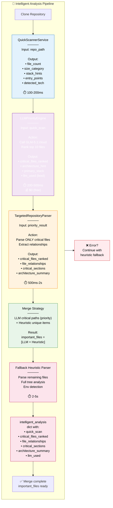
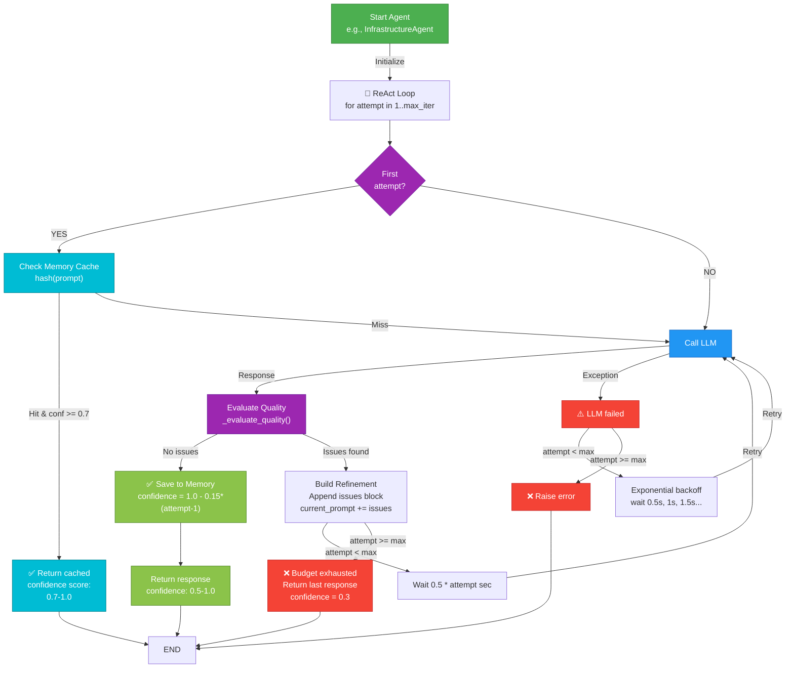
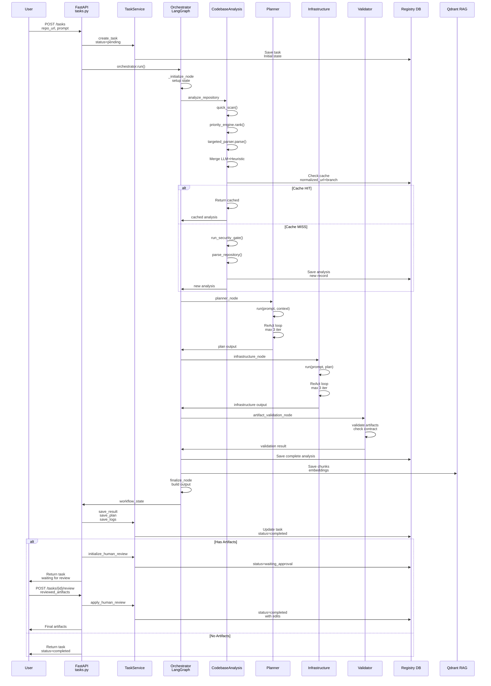
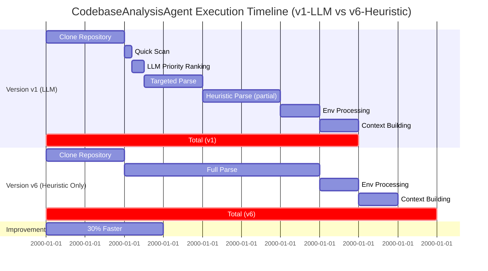

# DevSecOps AI Platform - Workflow Architecture (Mermaid)

## 1. Complete Workflow Architecture

```mermaid
graph TD
    %% Entry Point
    USER["👤 User Request"] -->|POST /tasks| API["FastAPI Endpoint<br/>tasks.py"]

    %% Task Creation
    API -->|Parse Request| TASK_CREATE["TaskService.create_task<br/>Status: pending"]
    TASK_CREATE -->|Update Status| IN_PROGRESS["Status: in_progress<br/>Save to DB"]

    %% Orchestrator Setup
    IN_PROGRESS -->|Initialize| ORCH["OrchestratorAgent<br/>LangGraph"]

    %% Orchestrator Workflow - LangGraph DAG
    subgraph WORKFLOW["🔄 Orchestrator Workflow (LangGraph DAG)"]
        INIT["1️⃣ initialize<br/>Setup state"] -->|Logs| REPO_ANALYSIS["2️⃣ analyze_repository<br/>CodebaseAnalysisAgent"]

        %% Repository Analysis with Intelligent Pipeline
        REPO_ANALYSIS -->|Quick Scan| QUICK["QuickScannerService<br/>Detect stack & entry points"]
        QUICK -->|Priority Ranking| LLM_RANK["LLMPriorityEngine<br/>GLM-5.1:cloud<br/>Rank critical files"]
        LLM_RANK -->|Target Parse| TARGETED["TargetedRepositoryParser<br/>Parse critical files only"]
        TARGETED -->|Merge Results| MERGE["Merge LLM + Heuristic<br/>Important files ranked"]
        MERGE -->|Cache Decision| CACHE["Check Registry Cache<br/>unchanged/new/changed"]

        CACHE -->|unchanged| RETURN_CACHED["Return Cached Analysis<br/>Fast path"]
        CACHE -->|new/changed| SEC_GATE["Security Gate<br/>Scan for vulns/secrets"]

        SEC_GATE -->|BLOCKED| FINALIZE_BLK["❌ Finalize<br/>Security blocked"]
        SEC_GATE -->|✅ OK| PLANNER["3️⃣ planner<br/>PlannerAgent<br/>Generate plan"]

        RETURN_CACHED --> PLANNER

        PLANNER -->|plan + context| PLAN_OUT["Plan Output<br/>steps, complexity<br/>required_artifacts"]
        PLAN_OUT -->|Check empty| PLAN_CHECK{Plan has<br/>artifacts?}

        PLAN_CHECK -->|NO| FINALIZE_EMPTY["Finalize<br/>Empty plan"]
        PLAN_CHECK -->|YES| INFRA["4️⃣ infrastructure<br/>InfrastructureAgent<br/>ReAct loop<br/>max 3 iterations"]

        INFRA -->|Generate| INFRA_OUT["Dockerfile<br/>docker-compose.yml<br/>Terraform<br/>Kubernetes<br/>CI/CD"]
        INFRA_OUT -->|Artifacts| FILTER["Filter Artifacts<br/>Keep only approved"]
        FILTER -->|Filtered| VALIDATE["5️⃣ artifact_validation<br/>ArtifactQualityValidator"]

        VALIDATE -->|Check Quality| VAL_RESULT{Validation<br/>Status?}

        VAL_RESULT -->|INVALID| FINALIZE_INV["❌ Finalize<br/>Validation failed"]
        VAL_RESULT -->|PARTIAL| CICD["6️⃣ cicd<br/>CICDAgent<br/>Generate pipelines"]
        VAL_RESULT -->|VALID| CICD

        CICD -->|Generate| CICD_OUT[".github/workflows<br/>GitLab CI<br/>Jenkins"]
        CICD_OUT -->|All done| FINALIZE["7️⃣ finalize<br/>Save results<br/>Build output"]

        FINALIZE_BLK --> END_BLOCKED["END<br/>Blocked"]
        FINALIZE_EMPTY --> END_EMPTY["END<br/>Empty"]
        FINALIZE_INV --> END_INVALID["END<br/>Invalid"]
        FINALIZE --> PERSIST["Save to DB<br/>Registry"]
    end

    %% Save to Database
    PERSIST -->|Save Analysis| DB_ANALYSIS["Database Registry<br/>analysis_output<br/>execution_trace<br/>llm_calls"]
    DB_ANALYSIS -->|Save Chunks| RAG_SAVE["Qdrant RAG<br/>Vector embeddings<br/>Semantic search"]

    %% Result Processing
    PERSIST -->|Has Artifacts?| HAS_ARTIFACTS{Artifacts<br/>Generated?}

    HAS_ARTIFACTS -->|YES| HUMAN_REVIEW["🧑‍⚖️ Human Review Gate<br/>Status: waiting_approval"]
    HAS_ARTIFACTS -->|NO| COMPLETE["✅ Status: completed<br/>Return results"]

    %% Human Review Loop
    HUMAN_REVIEW -->|User Review| REVIEW_API["POST /tasks/{id}/review<br/>ReviewArtifactsRequest"]
    REVIEW_API -->|Apply Changes| APPLY_REVIEW["TaskService<br/>apply_human_review"]
    APPLY_REVIEW -->|Update| REVIEWED["Status: completed<br/>with user edits"]

    %% Response
    COMPLETE --> RESPONSE["📦 Return TaskResponse<br/>plan, artifacts, logs"]
    REVIEWED --> RESPONSE

    RESPONSE -->|Return to User| USER_RESP["👤 User Receives<br/>All artifacts"]

    %% Styling
    classDef endpoint fill:#4CAF50,stroke:#2E7D32,color:#fff
    classDef agent fill:#2196F3,stroke:#1565C0,color:#fff
    classDef process fill:#FF9800,stroke:#E65100,color:#fff
    classDef decision fill:#9C27B0,stroke:#6A1B9A,color:#fff
    classDef database fill:#F44336,stroke:#C62828,color:#fff
    classDef end fill:#8BC34A,stroke:#558B2F,color:#fff

    class API,RESPONSE endpoint
    class ORCH,REPO_ANALYSIS,PLANNER,INFRA,VALIDATE,CICD agent
    class QUICK,LLM_RANK,TARGETED,MERGE,CACHE,SEC_GATE,FILTER process
    class PLAN_CHECK,VAL_RESULT,HAS_ARTIFACTS decision
    class DB_ANALYSIS,RAG_SAVE database
    class COMPLETE,USER_RESP end
```

---

## 2. Intelligent Analysis Pipeline (CodebaseAnalysisAgent Detail)



---

## 3. ReAct Loop (Inside Agents)



---

## 4. Memory & Caching System

```mermaid
graph TB
    subgraph SESSION["📊 Session Lifecycle"]
        START["Session Start<br/>Agent created"]

        START --> CREATE_MEM["Create AgentMemory()<br/>In-process dict<br/>max_entries=100<br/>ttl_seconds=None"]

        CREATE_MEM --> READY["Ready to cache<br/>prompt → output"]

        READY --> REQ1["Request 1:<br/>Prompt A"]
        REQ1 -->|hash| KEY1["key = SHA256(prompt_a)[:32]<br/>= a1b2c3d4..."]
        KEY1 -->|recall| MISS1["❌ Cache miss<br/>_(store is empty)"]
        MISS1 -->|LLM call| RESP1["Response A<br/>result: {...}"]
        RESP1 -->|remember| SAVE1["MemoryEntry<br/>key: a1b2c3d4...<br/>output: {...}<br/>confidence: 0.95<br/>timestamp: t1"]
        SAVE1 -->|_store[key]| STORED1["✅ Cached"]

        STORED1 --> REQ2["Request 2:<br/>Same Prompt A<br/>5 sec later"]
        REQ2 -->|hash| KEY2["key = SHA256(prompt_a)[:32]<br/>= a1b2c3d4..."]
        KEY2 -->|recall| HIT["✅ Cache hit!<br/>Check TTL<br/>(none, so valid)"]
        HIT -->|Check confidence| CONF_CHECK{conf >= 0.7?}
        CONF_CHECK -->|YES| RETURN["✅ Return Response A<br/>0 LLM calls!"]
        CONF_CHECK -->|NO| CALL_LLM["Call LLM again"]

        RETURN --> STATS["stats():<br/>cached_entries: 1<br/>decisions: N"]

        STATS --> SESSION_END["Session End<br/>Memory CLEARED<br/>(no restart persist)"]
    end

    SESSION_END --> PERSIST_OPT["Optional:<br/>Save to JSON file<br/>(currently unused)"]

    subgraph STORAGE["💾 Storage Tiers"]
        MEM["Tier 1: In-Process<br/>___<br/>Type: Python dict<br/>Speed: O1 lookup<br/>Size: 100 entries max<br/>Lifetime: Session<br/>Persistence: No"]

        OPT_JSON["Tier 2: JSON File<br/>___<br/>Type: JSON persist<br/>Speed: Slow (I/O)<br/>Persistence: Optional"]

        RAG["Tier 3: Qdrant RAG<br/>___<br/>Type: Vector DB<br/>Purpose: Semantic chunks<br/>Persistence: Yes<br/>Use: Knowledge retrieval"]

        DB["Tier 4: SQL Registry<br/>___<br/>Type: SQLite/Postgres<br/>Purpose: Analysis records<br/>Persistence: Yes<br/>Use: History tracking"]

        MEM -.optional.-> OPT_JSON
        MEM -->|separate| RAG
        MEM -->|separate| DB
    end

    classDef session fill:#E8F5E9,stroke:#388E3C,color:#000
    classDef cache fill:#E3F2FD,stroke:#1976D2,color:#000
    classDef hit fill:#C8E6C9,stroke:#2E7D32,color:#000
    classDef miss fill:#FFCDD2,stroke:#C62828,color:#000
    classDef storage fill:#FFF3E0,stroke:#F57C00,color:#000

    class SESSION,START,CREATE_MEM,READY,STATS,SESSION_END session
    class REQ1,REQ2,KEY1,KEY2,STORED1 cache
    class HIT,RETURN,CONF_CHECK,SAVE1 hit
    class MISS1 miss
    class STORAGE,MEM,OPT_JSON,RAG,DB storage
```

---

## 5. Data Flow: Request to Response



---

## 6. Agent Stack & Dependencies

```mermaid
graph TB
    subgraph AGENTS["🤖 Agents Layer"]
        BASE["BaseAgent<br/>Abstract"]
        ENHANCED["EnhancedBaseAgent<br/>ReAct loop<br/>Memory<br/>Validation"]

        BASE -->|extends| ENHANCED

        CODEBASE["CodebaseAnalysisAgent<br/>Analyze repo<br/>LLM priority ranking<br/>Cache"]
        PLANNER["PlannerAgent<br/>Generate plan<br/>Multi-plan scoring"]
        INFRA["InfrastructureAgent<br/>Generate artifacts<br/>RAG support"]
        CICD["CICDAgent<br/>Generate CI/CD<br/>GitHub Actions"]

        ENHANCED -->|base| CODEBASE
        ENHANCED -->|base| PLANNER
        ENHANCED -->|base| INFRA
        ENHANCED -->|base| CICD
    end

    subgraph SERVICES["🔧 Services Layer"]
        GITHUB["GitHubService<br/>Clone<br/>Metadata"]

        QUICK["QuickScannerService<br/>Fast scan"]
        LLM_PRIORITY["LLMPriorityEngine<br/>GLM ranking"]
        TARGETED["TargetedRepositoryParser<br/>Deep parse<br/>critical files"]

        PARSER["RepositoryParserService<br/>Full parse<br/>Heuristic"]

        SEC["RepositorySecurityService<br/>Scan vulns"]
        ENV_DET["EnvFileDetectorService<br/>Find .env"]
        ENV_SAN["EnvSanitizerService<br/>Mask secrets"]

        CONTEXT["ContextBuilderService<br/>RAG context"]
        FINGERPRINT["RepositoryFingerprintService<br/>Build identity"]
        REGISTRY["RepositoryRegistryService<br/>Save analysis<br/>Cache lookup"]

        TASK_SVC["TaskService<br/>Create/Update<br/>tasks"]
        TRACE["ExecutionTraceService<br/>Build logs"]
    end

    subgraph INFRASTRUCTURE["⚙️ Infrastructure Layer"]
        RAG_SERVICE["RAGService<br/>Chunking<br/>Embedding"]
        QDRANT["QdrantService<br/>Vector DB"]
        LLM["LLMService<br/>Groq/Ollama<br/>Chat"]
        DB["DatabaseService<br/>SQLite/Postgres"]
    end

    subgraph MEMORY["💾 Memory Layer"]
        AGENT_MEM["AgentMemory<br/>In-process<br/>Prompt cache"]
        VALIDATION["ValidationService<br/>Rule-based<br/>Artifact checks"]
    end

    CODEBASE -->|uses| GITHUB
    CODEBASE -->|uses| QUICK
    CODEBASE -->|uses| LLM_PRIORITY
    CODEBASE -->|uses| TARGETED
    CODEBASE -->|uses| PARSER
    CODEBASE -->|uses| SEC
    CODEBASE -->|uses| ENV_DET
    CODEBASE -->|uses| ENV_SAN
    CODEBASE -->|uses| FINGERPRINT
    CODEBASE -->|uses| REGISTRY
    CODEBASE -->|uses| TRACE

    PLANNER -->|uses| LLM
    INFRA -->|uses| LLM
    INFRA -->|uses| RAG_SERVICE

    ENHANCED -->|uses| AGENT_MEM
    ENHANCED -->|uses| VALIDATION

    PARSER -->|uses| CONTEXT
    RAG_SERVICE -->|uses| QDRANT
    REGISTRY -->|uses| DB

    classDef agent fill:#2196F3,stroke:#1565C0,color:#fff
    classDef service fill:#FF9800,stroke:#E65100,color:#fff
    classDef infra fill:#9C27B0,stroke:#6A1B9A,color:#fff
    classDef memory fill:#00BCD4,stroke:#00838F,color:#fff

    class BASE,ENHANCED,CODEBASE,PLANNER,INFRA,CICD agent
    class GITHUB,QUICK,LLM_PRIORITY,TARGETED,PARSER,SEC,ENV_DET,ENV_SAN,CONTEXT,FINGERPRINT,REGISTRY,TASK_SVC,TRACE service
    class RAG_SERVICE,QDRANT,LLM,DB infra
    class AGENT_MEM,VALIDATION memory
```



---

## 7. Performance Timeline



